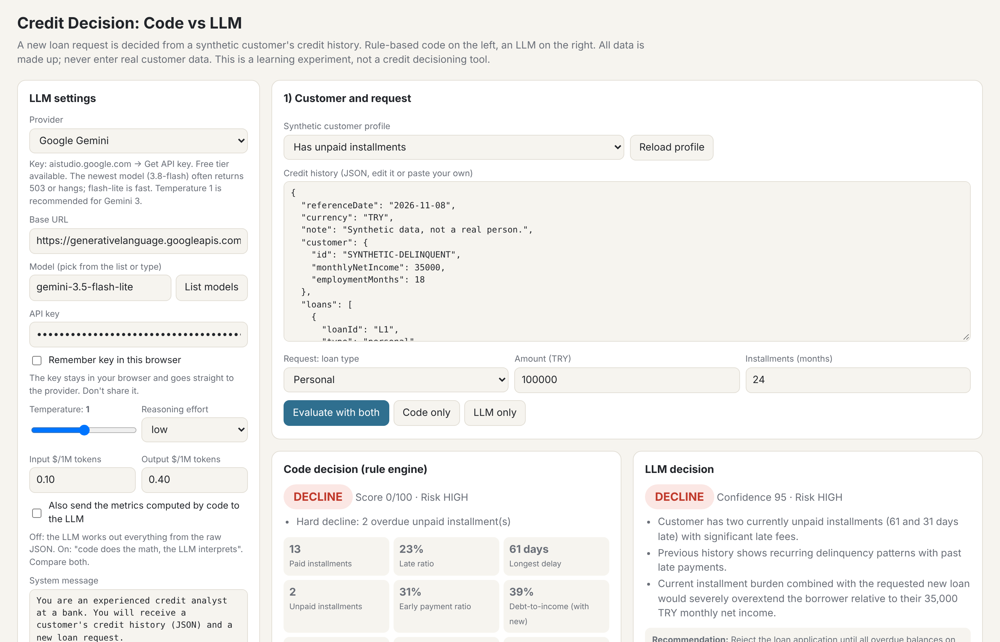

# Credit Decision: Code vs LLM

A small, single-file experiment: the same synthetic credit history is judged by a rule-based scorecard (code) and by an LLM, side by side.

## Run it

1. Download `index.html`.
2. Double-click it. It opens in your browser; nothing to install.
3. Pick a provider (Google Gemini and Groq have free tiers), paste your API key and click **Evaluate with both** or **Run batch test**.

Your key stays in your browser and is sent only to the provider you pick. Never commit it, paste it in screenshots or share it.

## What's inside

- **Six synthetic customers** (no real data): clean payer, occasional late payer, chronic late payer, unpaid installments, thin file, heavily indebted.
- **Rule engine:** hard declines (unpaid installments, 90+ days late, debt-to-income above 50%), then a 100-point scorecard.
- **LLM:** gets the same JSON and a "credit analyst" system message, answers in a fixed JSON format.
- **Toggle:** send the metrics computed by code (installment, debt-to-income, late ratio...) to the LLM as well.
- **Providers:** Gemini, OpenAI, Anthropic, Groq, OpenRouter, Hugging Face, Ollama, LM Studio, llama.cpp, or any OpenAI-compatible endpoint.

## Results (gemini-3.5-flash-lite, temperature 1)

| | Agreed with the code |
|---|---|
| Raw JSON only (4 runs) | 11 of 24 (46%) |
| + code's metrics (3 runs) | 10 of 18 (56%) |

Write-up: *I Let an LLM Make Credit Decisions. Here's Where It Broke.* (Medium)

## Disclaimer

A learning experiment, not a credit decisioning tool. Rates and limits are example assumptions, not real bank policy. Never send real customer data to a cloud LLM.

## License

MIT
